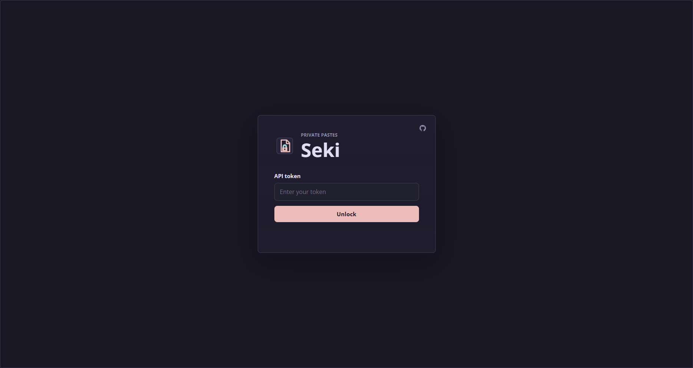
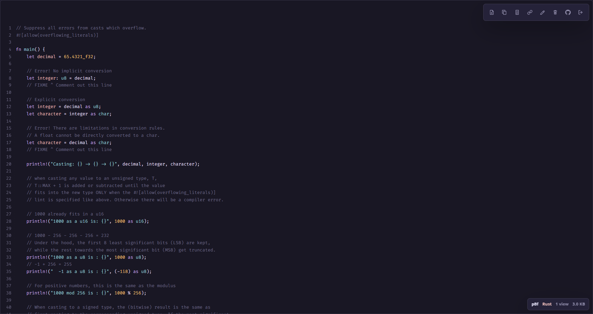
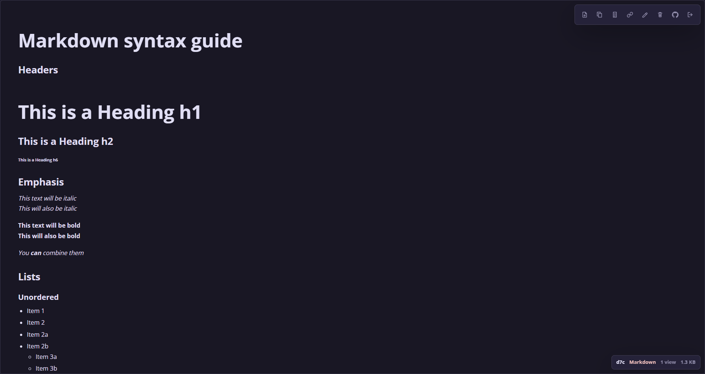

# <p style="text-align: center;">Seki</p>

Private paste service on Node.js and Express





## Purpose

Seki stores text pastes as plain text files and serves them through short links. It is built for private use by a small group: creating, deleting, and renaming pastes requires an API token, while viewing a paste or its raw version is public to anyone with the link

## Features

- Private writes and public reads: creating, deleting, and renaming require a token, viewing works by link
- No database: metadata is stored in `data/index.json`, paste content in `data/pastes/`
- Raw text view at `/:id/raw`
- Automatic language detection and syntax highlighting with `highlight.js`
- Markdown pastes render as HTML in the viewer and stay plain text in raw mode
- Large pastes skip expensive highlighting and stay readable as plain text
- Open Graph/Twitter metadata
- Link renaming through API/UI
- View counter
- Configurable paste size limit
- Atomic index writes through temp file + rename

## Deployment

Requires Node.js 18+

```bash
git clone https://github.com/FrostyDeFreeze/seki
cd seki
npm i
cp .env.example .env
npm start
```

Minimal `.env`:

```env
PORT=7250
BASE_URL=http://localhost:7250
API_TOKEN=super-secret-token

PASTE_CODE_LENGTH=3
PASTE_MAX_SIZE=1048576 # in bytes
HIGHLIGHT_MAX_SIZE=262144 # in bytes

DATA_DIR=./data
```

For production, run the service behind a reverse proxy and set `BASE_URL` to the public URL

Data lives in `DATA_DIR`

Back up both `index.json` and the `pastes/` directory

## API

Protected endpoints use this header:

```http
Authorization: Bearer <API_TOKEN>
```

API errors use this format:

```json
{
	"success": false,
	"error": {
		"code": "bad_request",
		"message": "Paste content is required"
	}
}
```

| Method   | Endpoint          | Access  | Description                                                              | Body                                    | Response                                                                    |
| -------- | ----------------- | ------- | ------------------------------------------------------------------------ | --------------------------------------- | --------------------------------------------------------------------------- |
| `POST`   | `/auth/verify`    | Private | Checks that the token is valid                                           | -                                       | `{ "ok": true }`                                                            |
| `POST`   | `/api/pastes`     | Private | Creates a paste                                                          | `{ "content": "console.log('hello')" }` | `201` with `{ "success": true, "data": Paste }`                             |
| `GET`    | `/api/pastes/:id` | Public  | Returns a paste and increments its view counter                          | -                                       | `{ "success": true, "data": Paste }`                                        |
| `PATCH`  | `/api/pastes/:id` | Private | Renames a paste id and changes its short link                            | `{ "id": "release-notes" }`             | `{ "success": true, "data": Paste }` with updated `id`, `url`, and `rawUrl` |
| `DELETE` | `/api/pastes/:id` | Private | Deletes a paste from the index and removes its file from disk            | -                                       | `{ "success": true, "data": ... }` with the deleted paste metadata          |
| `GET`    | `/:id`            | Public  | Opens the HTML paste viewer                                              | -                                       | HTML                                                                        |
| `GET`    | `/:id/raw`        | Public  | Returns the original paste as plain text and increments its view counter | -                                       | `text/plain; charset=utf-8`                                                 |

`Paste` includes the paste metadata, `content`, `renderMode`, and rendered fields when they are available. Markdown pastes return `renderMode: "markdown"` with `renderedHtml`. Code pastes return `renderMode: "code"` with `highlightedHtml` when the paste size does not exceed `HIGHLIGHT_MAX_SIZE`.
