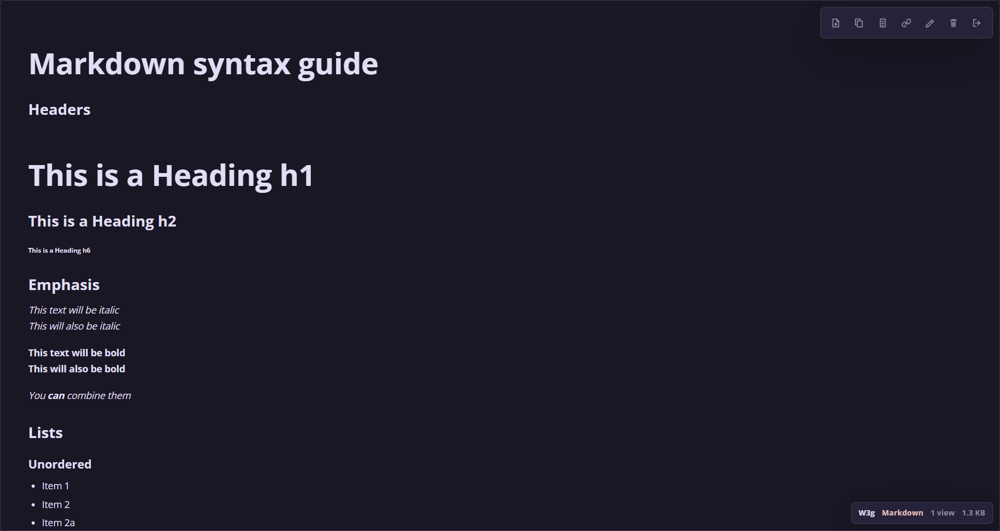

# Seki

Private paste service on Node.js and Express




## Purpose

Seki stores text pastes as plain text files and serves them through short links. It is built for private use by a small group: creating, deleting, and renaming pastes requires an API token, while viewing a paste or its raw version is public to anyone with the link

## Features

- Private writes and public reads: creating, deleting, and renaming require a token, viewing works by link
- Short paste links with configurable id length
- No database: metadata is stored in `data/index.json`, paste content in `data/pastes/`
- Raw text view at `/:id/raw`
- Automatic language detection and syntax highlighting with `highlight.js`
- Markdown pastes render as HTML in the viewer and stay plain text in raw mode
- Large pastes skip expensive highlighting and stay readable as plain text
- Link renaming through API/UI: `/:id` can become a custom slug
- View counter
- Paste deletion through `DELETE`
- Configurable paste size limit
- Atomic index writes through temp file + rename

## Deployment

Requires Node.js 18+

```bash
npm install
cp .env.example .env
npm start
```

Minimal `.env`:

```env
PORT=7250
BASE_URL=http://localhost:7250
API_TOKEN=super-secret-token

PASTE_CODE_LENGTH=3
PASTE_MAX_SIZE=1048576
HIGHLIGHT_MAX_SIZE=262144

DATA_DIR=./data
```

For production, run the service behind a reverse proxy and set `BASE_URL` to the public URL

Data lives in `DATA_DIR`

Back up both `index.json` and the `pastes/` directory

## API

Protected endpoints use this header:

```http
Authorization: Bearer <API_TOKEN>
```

API errors use this format:

```json
{
	"success": false,
	"error": {
		"code": "bad_request",
		"message": "Paste content is required"
	}
}
```

### `POST /auth/verify`

Verifies the API token

Requires authorization

Response:

```json
{ "ok": true }
```

### `POST /api/pastes`

Creates a paste

Requires authorization

Request body:

```json
{
	"content": "console.log('hello')"
}
```

Response:

```json
{
	"id": "gzC",
	"file": "gzC.txt",
	"url": "https://p.example.com/gzC",
	"rawUrl": "https://p.example.com/gzC/raw",
	"language": "Plain text",
	"languageKey": "plaintext",
	"relevance": 1,
	"size": 28,
	"createdAt": "2026-05-27T18:58:42.559Z",
	"views": 0
}
```

### `GET /api/pastes/:id`

Returns a paste and increments its view counter

Public endpoint

Markdown pastes return `renderMode: "markdown"` and `renderedHtml`. Code pastes return `renderMode: "code"` and `highlightedHtml` when the paste size does not exceed `HIGHLIGHT_MAX_SIZE`

### `PATCH /api/pastes/:id`

Renames a paste id, changing its short link

Requires authorization

Request body:

```json
{
	"id": "release-notes"
}
```

The response contains the updated `id`, `url`, and `rawUrl`

### `DELETE /api/pastes/:id`

Deletes a paste from the index and removes its file from disk

Requires authorization

### `GET /:id`

Opens the HTML paste viewer

Public route

### `GET /:id/raw`

Returns the original paste content as `text/plain; charset=utf-8` and increments the view counter

Public route
